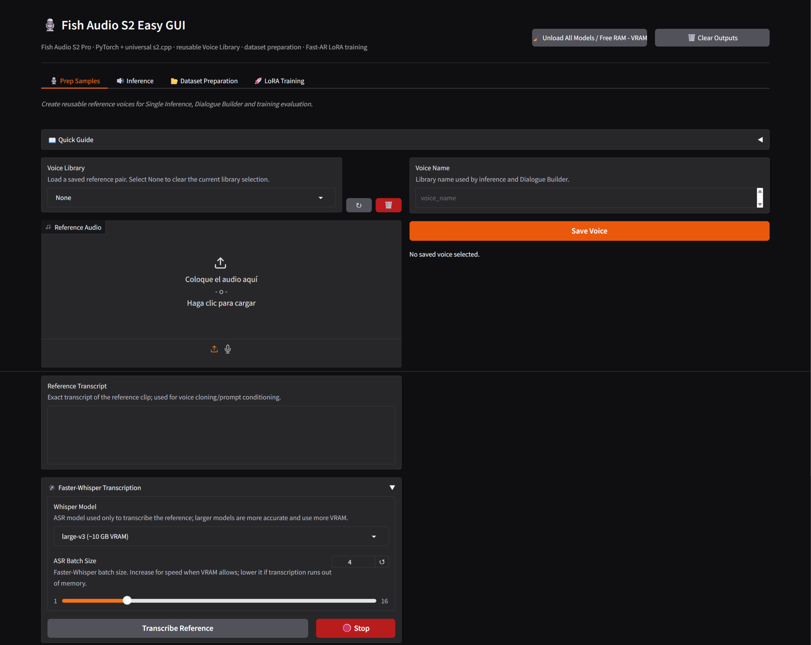
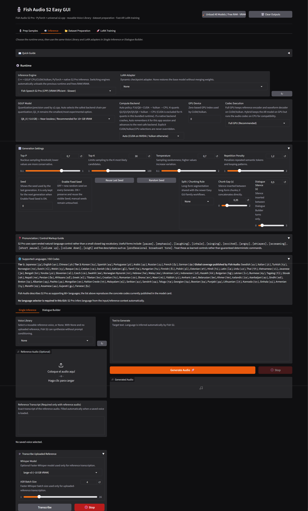
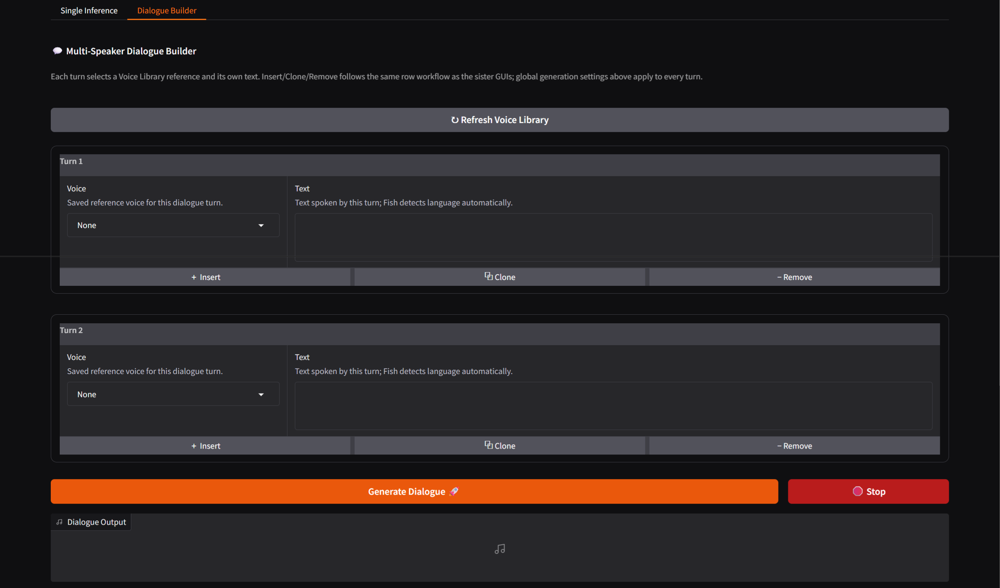
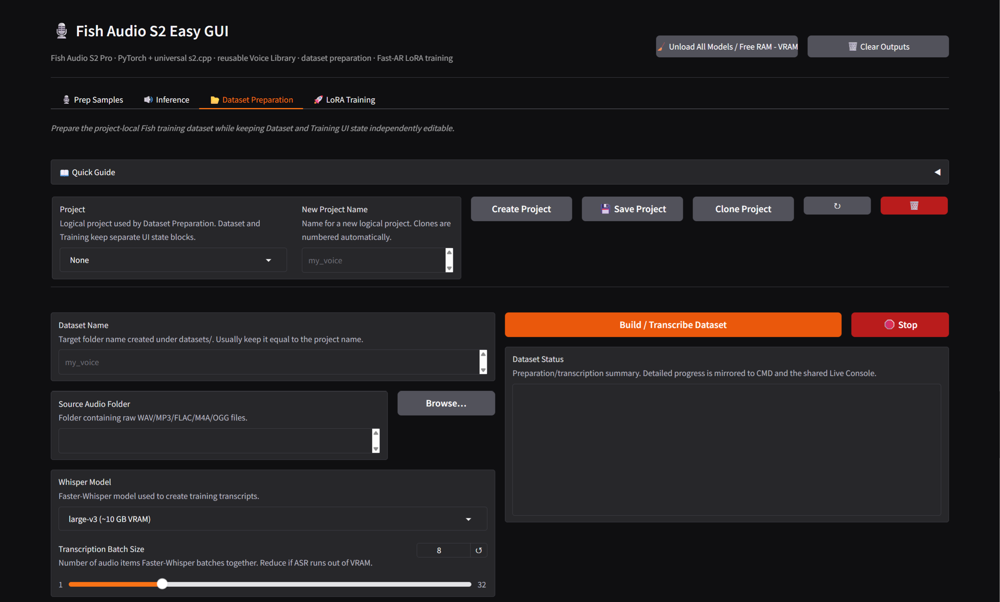
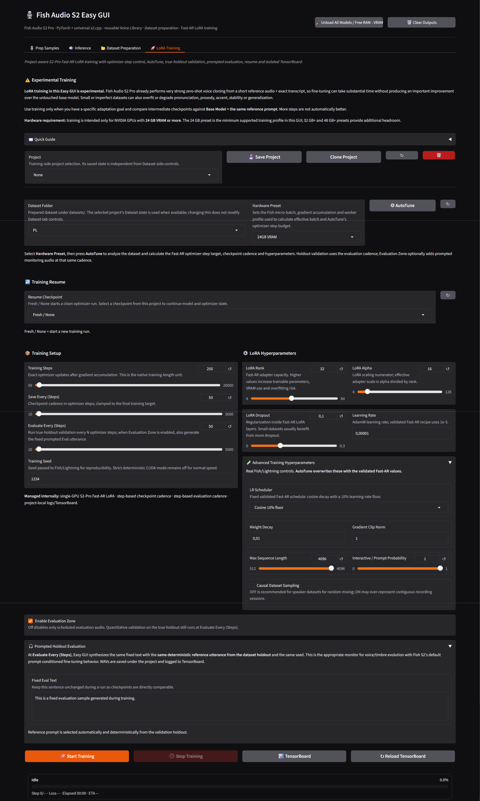

## 🎙️ Fish Audio S2 Easy GUI

A Windows-first, self-contained Easy GUI for **Fish Audio S2 Pro**. It combines native PyTorch inference, a managed **s2.cpp** GGUF runtime, reusable reference voices, single-speaker synthesis, multi-speaker dialogue, Faster-Whisper transcription, project-based dataset preparation and Fast-AR-only LoRA training in one Gradio application.

> [!IMPORTANT]
> **LoRA training is experimental.** S2 Pro already provides strong zero-shot cloning from short reference audio and its exact transcript. Fine-tuning can take significant time, provide little improvement, or degrade pronunciation, prosody, accent, stability or generalization.
>
> Training is intended for **NVIDIA GPUs with 24 GB VRAM or more**; 24 GB is the minimum supported profile.

---

## 🪟 Windows installation

Clone the repository:

```cmd
git clone -b windows-rewrite https://github.com/Mixomo/Fish_audio_S2_Simple_GUI.git
```

Or change the branch to windows-rewrite and donwload the project in .zip format

Then Run:

```cmd
install.bat
```

The installer keeps Python, tools, caches, the Vulkan SDK and generated native build state inside the project. It does not depend on an external project path or global Python environment.

The managed stack includes project-local uv/Python 3.11.15, PyTorch 2.8.0 with CUDA 12.8, torchvision/torchaudio, Triton Windows, Gradio, Lightning, Hydra, TensorBoard, Faster-Whisper/CTranslate2, Hugging Face Hub, CMake, Ninja, Visual C++ tooling and the Vulkan SDK.

The native s2.cpp runtime is independent of PyTorch:

- If the configurable prebuilt URL in install.ps1 is available, the installer downloads and validates the universal CPU/CUDA/Vulkan runtime and skips local native compilation.
- Otherwise CMake, Ninja, MSVC and the Vulkan SDK are installed or reused under .runtime/ and s2.cpp is compiled locally.
- The archive must contain s2.exe, CPU/CUDA/Vulkan DLLs and the required x64 MSVC/OpenMP runtime DLLs.

---

## ▶️ Launch

After installation:

```cmd
start.bat
```

The launcher restores project-local variables and starts Gradio at http://127.0.0.1:7860. The browser opens automatically; the environment is not reinstalled on every launch.

---

## 🧠 S2 Pro architecture and Fast-AR training scope

Fish Audio S2 Pro uses a **Dual-AR** architecture. The semantic/language branch remains frozen, **Fast AR** predicts the residual acoustic codebooks and the codec reconstructs the waveform.

## 🖥️ Interface

The application has four workflow tabs and one shared console.

## 1. 🎙️ Prep Samples



Creates reusable reference voices. A saved voice contains reference audio and its exact transcript and can be used by Single Inference, Dialogue Builder and prompted training evaluation.

Faster-Whisper can transcribe an uploaded sample when an exact transcript is unavailable. Clean speech with minimal noise, music, reverb or overlapping speakers gives the most reliable conditioning.

---

## 2. 🔊 Inference



Inference contains shared runtime/generation settings and two surfaces:

- **Single Inference**
- **Dialogue Builder**

### Inference engines

#### PyTorch

Uses native S2 Pro weights and the project CUDA runtime. It supports native LoRA checkpoints and Fast-AR-only adapters, manages torch.compile automatically, and falls back from the stable Windows path to Default and eager execution if needed. The first compiled generation can be slower; later generations are normally faster.

#### s2.cpp / GGUF

Uses the native runtime with selectable GGUF model, compute backend, GPU device and codec execution. Auto uses **CUDA → Vulkan → CPU** for F16/Q8 and **Vulkan → CPU** for K-quants in the bundled runtime. Explicit backend choices are not silently replaced; Auto remembers failed backends for the current session.

**Codec Execution**

- **Full GPU (Recommended)** — inference and codec work use the selected GPU backend.
- **Hybrid (GPU model + CPU codec)** — inference stays on GPU and the codec runs on CPU for compatibility and VRAM headroom.

Long Full GPU decodes use an adaptive codec window based on free VRAM. Supported windows are 96, 128, 160 and 192 frames; allocation failure retries a smaller window. The native CLI can force one with --gpu-window.

### Runtime switching and memory

Switching engines is a hard memory boundary. **Unload All Models / Free RAM - VRAM** releases PyTorch model/codec state, LoRA mounts, compile wrappers, the managed s2.cpp process, CUDA caches, Python garbage and reclaimable Windows working-set memory. Starting training unloads inference models first.

### Voice conditioning

Reference audio plus its exact transcript enables prompt-conditioned cloning. Without a reference, S2 Pro performs native no-reference generation; timbre is not expected to remain identical across random seeds.

### Generation settings

Top-P, Top-K and Temperature control sampling diversity; Repetition Penalty discourages loops. Split / Chunking Rule and Chunk Gap control optional long-form segmentation; Dialogue Silence controls gaps between Dialogue Builder turns.

### Enable Fixed Seed

With the option off, each generation receives a fresh seed and writes it back to the Seed field. With it on, the visible seed is reused; if it is 0, the first generation creates one. **Random Seed** creates a new value and **Reuse Last Seed** restores the previous one. The behavior is shared by Single Inference and Dialogue Builder.

### Long-form synthesis

The default is **None**, sending one uninterrupted request. Paragraph, sentence or line rules can split longer material. Chunk Gap only affects long-form joins; Dialogue Silence is independent.

### Dialogue Builder



Supports multiple turns with a Voice Library reference, independent text and Insert / Clone / Remove row operations. Global generation controls are shared across turns.

### Pronunciation / control markup

S2 Pro supports learned natural-language and bracketed cues for emotion, whispering, pauses, emphasis, breathing and descriptive style. These are learned model behavior, not a guaranteed deterministic command parser.

---

## 3. 📂 Dataset Preparation



Dataset Preparation is project-aware and keeps its state separate from Training. It can ingest/normalize audio, transcribe missing text with Faster-Whisper, create .lab transcripts, extract Fish VQ/semantic data, create Fish protobuf training data, reuse current preprocessing and save/load Dataset project state.

### True validation holdout

For datasets large enough to support it, the GUI creates a deterministic training/validation split:

```text
datasets/<dataset>/
└─ _fish_split/
   ├─ protos_train/
   ├─ protos_val/
   └─ split.json
```

Small datasets that cannot support a meaningful holdout keep usable samples for training and do not claim independent evaluation.

---

## 4. 🚀 LoRA Training

> [!WARNING]
> Training is optional and experimental. Compare every checkpoint with the untouched base model using the same reference prompt; more steps are not automatically better.
>
> **Minimum intended hardware: NVIDIA GPU with 24 GB VRAM.**



### Hardware Preset → Fast-AR AutoTune

Select the prepared dataset, choose **Hardware Preset**, then press **AutoTune**. Profiles are **24GB VRAM**, **32GB+ VRAM** and **48GB+ VRAM**. AutoTune proposes optimizer steps, checkpoint cadence and Fast-AR hyperparameters from the dataset and hardware profile.

### Optimizer-step training

Training length is expressed only in optimizer steps. The GUI exposes Training Steps, Save/Evaluate Every (Steps), Training Seed, LoRA Rank/Alpha/Dropout, Learning Rate, Weight Decay, Max Sequence Length, Interactive / Prompt Probability, Gradient Clip Norm, Causal Dataset Sampling, LR Scheduler and Fast-AR Rank/Alpha. Gradient accumulation is selected internally by the hardware profile.

The validated default proposal is rank 32, alpha 16, dropout 0.10, learning rate 1e-5, max length 4096 and cosine decay to a 10% learning-rate floor.

### Scheduler

The only exposed scheduler is CosineAnnealingLR: T_max equals the requested optimizer-step budget and eta_min is 10% of the starting learning rate.

### Fresh / Resume

**Fresh / None** starts a clean optimizer run and removes the previous Training run directory without touching dataset files. **Resume Checkpoint** entries come from project checkpoints.

### Checkpoints

Checkpoints are saved at optimizer-step cadence and become available in the Inference LoRA dropdown. Intermediate checkpoints matter; more training is not automatically better.

### Prompted Holdout Evaluation

The optional Evaluation Zone keeps one validation reference, transcript, evaluation sentence and seed constant across checkpoints, making prompted WAVs comparable. Quantitative true-holdout validation remains separate.

### TensorBoard

Each Training project has its own logging directory with training scalars and, when enabled, prompted evaluation audio.

### Stop Training

Stop Training requests a graceful interruption so already-written checkpoints remain usable.

---

## 🧩 LoRA inference

Training checkpoints are discovered recursively from the selected project's results tree.

## PyTorch

PyTorch reconstructs the LoRA topology from the saved project YAML and verifies checkpoint tensors before inference, restoring rank, alpha, dropout and target modules. Invalid Fast-AR mappings are rejected.

## Native C++ .s2lora

The native adapter format is intentionally **Fast-AR-only**. The exporter validates this before creating the adapter. Fast-AR adapters work with PyTorch and the compatible native C++ path and remain separate from the base model.

---

## 🎛️ Memory lifecycle

The GUI manages PyTorch model/codec/LoRA state, compile wrappers, the s2.cpp process, CUDA allocator cache, Python garbage and Windows working-set pages during engine switches, manual unloads and training start. Training never intentionally shares a resident inference model.

---

## 📊 Progress and console

The shared **Live Console** and Gradio status report inference phases; training state, optimizer step, target steps, percentage, loss, elapsed time and ETA; and dataset/transcription progress.

---

## 📦 Models and downloads

Large assets are downloaded on demand into project-local locations: Fish Audio S2 Pro native weights, the S2 codec, the selected GGUF model and Faster-Whisper when transcription is used. Hugging Face downloads use project-local caches and hf-xet when available.

---

## 📂 Important directories

```text
Fish_audio_S2_Simple_GUI-main_windows/
├─ app.py
├─ fish_backend.py
├─ install.bat
├─ install.ps1
├─ start.bat
├─ README.md
├─ LICENSE
├─ .venv/
├─ .runtime/
├─ fish_easy/
│  ├─ projects.py
│  └─ cpp_lora.py
├─ modules/
│  ├─ s2/
│  │  ├─ fish_speech/
│  │  └─ results/
│  └─ s2.cpp/
├─ models/
├─ samples/
├─ outputs/
├─ datasets/
└─ projects/
```

- models/ — downloaded model assets.
- samples/ — reusable Voice Library material.
- outputs/ — generated inference/dialogue WAV files.
- datasets/ — prepared training data and deterministic splits.
- projects/ — Easy GUI project-state metadata.
- modules/s2/results/ — runs, checkpoints, evaluation audio and TensorBoard logs.

These local/generated directories are excluded from publication by the root .gitignore.

---

## 🧪 Recommended training workflow

1. Test the base S2 Pro model with a clean reference and exact transcript.
2. Train only for a specific adaptation goal.
3. Prepare a consistent single-speaker dataset with a real holdout.
4. Use **Fast AR — Validated Speaker/Timbre** through AutoTune.
5. Save intermediate checkpoints and enable prompted evaluation when useful.
6. Compare each candidate with **Base Model + the same reference prompt**.
7. Keep the earliest checkpoint that improves the target without hurting pronunciation, stability or generalization.

---

## ⚠️ Practical limitations

- LoRA training is experimental and may not outperform prompt cloning.
- Training targets 24 GB+ NVIDIA GPUs.
- Fixed sampling seeds do not guarantee bit-identical execution across all backends and kernels.
- The first compiled PyTorch generation can be much slower than later ones.
- Cloning quality depends strongly on reference cleanliness and transcript accuracy.

---

## 🔗 Upstream / acknowledgements

Inspired by [FranckyB](https://github.com/FranckyB) [Voice Clone Studio](https://github.com/FranckyB/Voice-Clone-Studio)

Based on [Fish Speech S2 PRO](https://huggingface.co/fishaudio/s2-pro) by [Fish Audio](https://github.com/fishaudio)

---

## License

See [LICENSE](LICENSE) and the licenses of the upstream projects and models used by this application.
